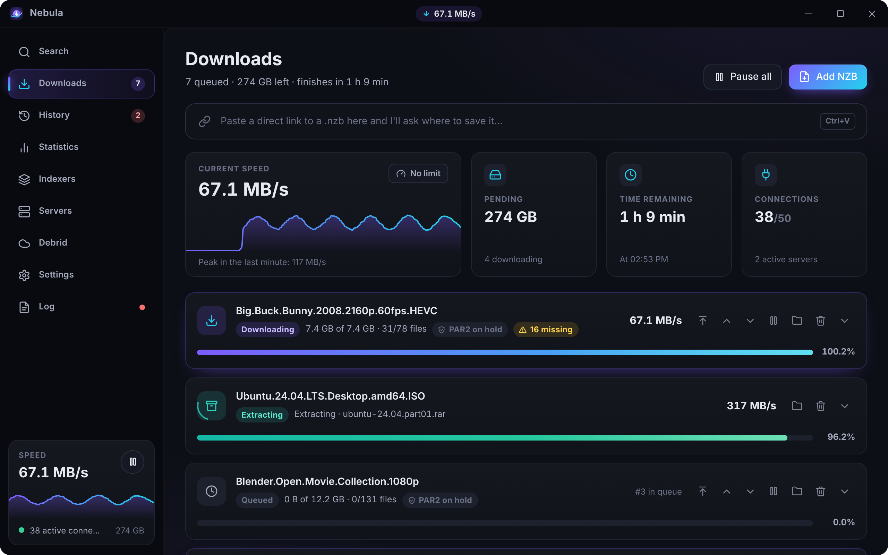
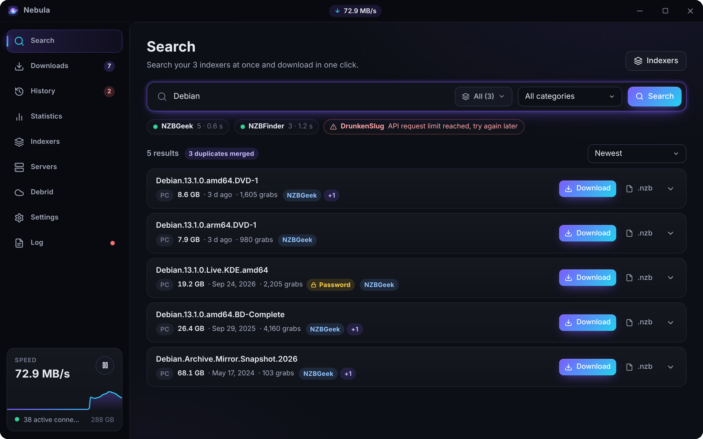
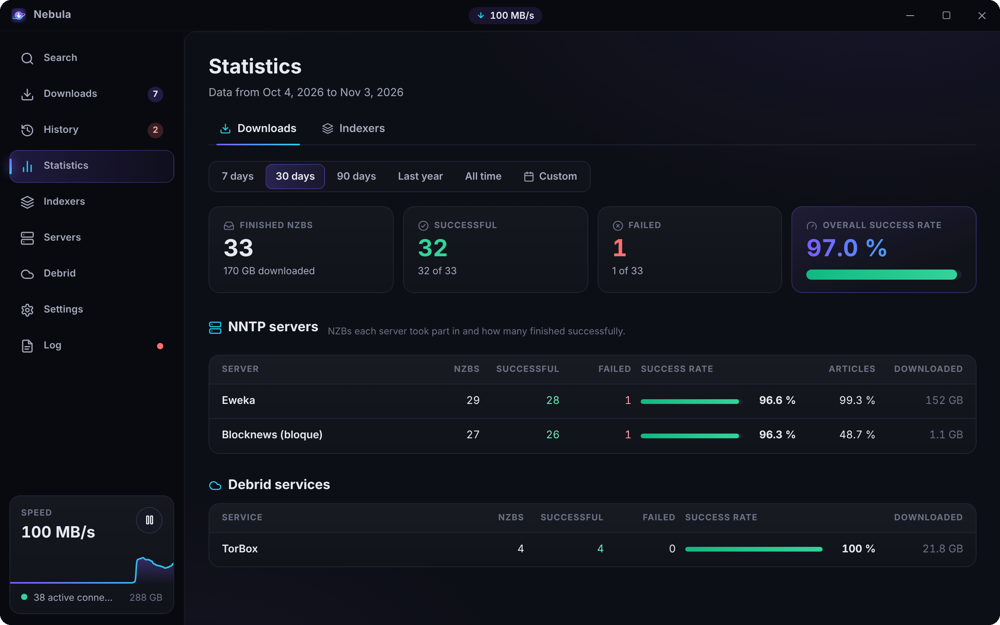
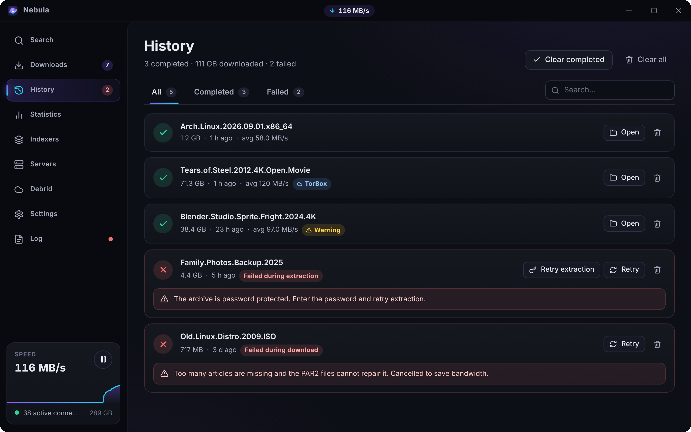
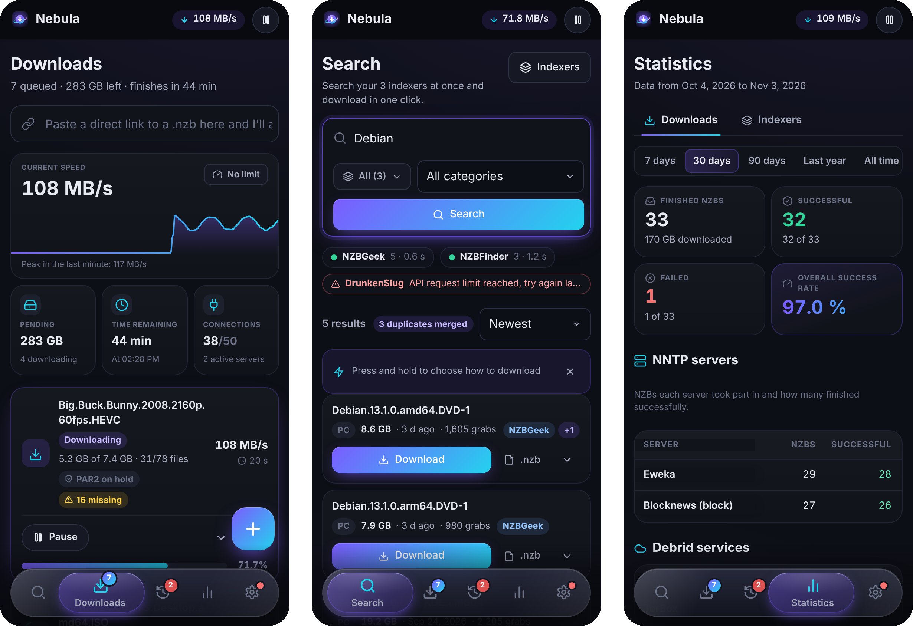

<div align="center">


# Nebula Usenet

**A modern Usenet (NZB) client for Windows, Android and Linux servers.**<br>
Search all your indexers, download over NNTP or debrid, repair and extract automatically, all from one fast, dark, animated app. An alternative to SABnzbd and NZBGet.

[](https://github.com/Comasss/nebula-usenet/releases/latest)
[](https://github.com/Comasss/nebula-usenet/releases)
[](https://github.com/Comasss/nebula-usenet/actions/workflows/build.yml)

[](LICENSE.md)

[**Download**](https://github.com/Comasss/nebula-usenet/releases/latest) · [Features](#features) · [Screenshots](#screenshots) · [Categories](docs/CATEGORIES.md) · [Newznab API](docs/API.md) · [SABnzbd API](docs/SABNZBD.md) · [Server](docs/SERVER.md) · [Docker](docs/DOCKER.md) · [CLI](docs/CLI.md) · [Download options](docs/DOWNLOADING.md) · [Building](#building)



</div>

## Features

- **Rust engine** (Tauri 2 + tokio): NNTP with TLS, multiple connections, backup servers by priority, yEnc decoding with CRC checks, direct-to-disk writes and resuming after the app is closed.
- **Built-in post-processing**: PAR2 verification and repair (par2cmdline-turbo) that downloads only the recovery blocks it needs, and RAR/7z/ZIP extraction (7-Zip), with a progress bar, percentage and speed. Both tools ship **inside the .exe**.
- **Smarter downloading**: an optional `STAT` pre-check that cancels a download before it starts if it can't be completed, real names for obfuscated files (from the PAR2 and the download's name), extracting each archive as soon as it's complete, fallback passwords, a filter for unwanted files such as `.exe`, duplicate detection, a scheduler that pauses, resumes or limits the speed at set times, and a download quota per server. See [docs/DOWNLOADING.md](docs/DOWNLOADING.md).
- **Newznab indexer search** (NZBGeek, NZBFinder, DrunkenSlug…): several at once or only the ones you pick, with category filter, sorting and optional grouping of duplicates (the same release reposted to several indexers shows up once and, if one indexer fails to download, the next one is used). Download with one click or save the `.nzb` to your PC.
- **Downloads through debrid services** (TorBox Pro and Premiumize): Nebula sends them the NZB, they download it (and repair/extract it) on their servers, and Nebula fetches the loose files over HTTPS with several ranged connections, to the same place and in the same layout as over NNTP (never a `.zip`). You choose the default method and, for each NZB, NNTP or the service you want.
- **Categories** (`tv`, `movies`…), as in SABnzbd and NZBGet: each one has its own folder, download method (NNTP, a specific server, debrid or the default), priority (Force, High, Normal, Low) and post-processing level. Pick one when adding an NZB from anywhere (button, drag and drop, link, Android share, RSS rules, a phone controlling the PC); search results go on their own to the category that matches their Newznab category (`5000-5999` → `tv`, `2000-2999` → `movies`). Downloads and History show the category, and History can be filtered by it. A fixed **Default** category keeps the previous behaviour, and everything queued before updating moves to it. See [docs/CATEGORIES.md](docs/CATEGORIES.md).
- **Statistics**: overall NZB success rate and one per NNTP server (plus debrid services), for the last 7, 30 or 90 days, the last year, all time or a custom date range. Each server also shows how many of the articles it was asked for it actually had. An **Indexers** tab shows each indexer's average response time, average results per search (and for all of them combined), error rate, NZBs grabbed and how many of those downloaded successfully.
- **Automatic downloads by RSS**: in **Indexers → RSS** (on Android, **Settings → RSS**) each indexer offers its feed of new releases and you can add loose RSS URLs, each checked every 15 minutes by default (5 at least). Rules pick what to grab with required words or a regex, excluded words, size range and categories, and choose the download method (NNTP, a debrid service or the default) and folder. By default a rule only grabs what's published after you create it, an item is never grabbed twice and a release already in the queue or history is skipped. The rule editor has a **Preview** that shows which items in the current feeds would match and why, and a log lists every automatic grab. On Android it only works while the app is open.
- **Newznab API compatible with NZBHydra2**: optional, with its own API key. Sonarr, Radarr, Prowlarr and other apps can search all your indexers at once through Nebula as if it were a single indexer. See [docs/API.md](docs/API.md).
- **SABnzbd-compatible API**: on the same port and key, Sonarr, Radarr, Lidarr, Readarr and Prowlarr can add Nebula as a **SABnzbd** download client. They send NZBs with their category and priority, follow the queue, and import automatically when History says it's completed. **Settings → API** shows the values to fill in. See [docs/SABNZBD.md](docs/SABNZBD.md).
- **nebula-server for Linux, NAS and headless machines**: the same engine without a window, with the interface in the browser (a user and password are created on first start, and it works on a phone too) and the Newznab and SABnzbd APIs on the same port, for running next to Sonarr and Radarr. See [docs/SERVER.md](docs/SERVER.md).
- **`nebula` command line**: add NZBs, check the queue and history, pause, limit the speed and search your indexers on a nebula-server from the terminal (with `--json` for scripts and a live `nebula tui`), or download an NZB with `nebula get` without any server, with documented exit codes. See [docs/CLI.md](docs/CLI.md).
- **Move your settings between devices with a QR code**: in **Settings → Move to another device** the PC shows a QR code that you scan with Nebula on your phone. To go the other way, the PC shows a QR code with its address on your Wi-Fi and a one-time key; the phone scans it and sends its settings encrypted over the local network. Servers, indexers, debrid services, RSS feeds and rules, the API and preferences travel; folders, history and system-specific options (tray, start with Windows, vibration…) stay as they are. If you can't scan, copy the code and paste it on the other device.
- **Control your PC from your phone**: the Android app finds Nebula on your PC over the Wi-Fi, pairs with a 6-digit code you approve on the PC, and then shows the PC's downloads, history and statistics live. From the phone you can add NZBs, pause, resume, move and delete jobs and change the speed limit (never settings or passwords). See [Remote control](#remote-control-from-your-phone).
- **On finish actions** (**Settings → On finish**): when a download completes, when it fails or when the queue becomes empty (nothing paused or waiting left), Nebula can send a notification to **Discord** (webhook URL), **Telegram** (bot token + chat id), **ntfy** (server + topic) or any **webhook** (JSON POST), run a **script or program** with a time limit, or **shut down, sleep or hibernate** Windows after a 60 s countdown you can cancel from a small window, the notification or the tray. Each action picks which of the three cases trigger it and has a **Test** button. Shutdown can be armed "just this once" from the speed panel or the tray menu. Actions never hold up downloads and their errors go to the Log; tokens and webhook URLs are stored encrypted, and only notifications travel with "Move to another device" (on Android only notifications exist).
- **Pick your features** on first launch (at least one): indexers only (save `.nzb` files), indexers + NNTP, or NNTP only.
- **12 languages**: English, Spanish, Simplified Chinese, Hindi, Portuguese (Brazil), French, German, Russian, Japanese, Arabic, Italian and Catalan. On startup it uses the Windows language (or English if it isn't available), and you can change it in **Settings → Language**; the tray menu, notifications and error messages are translated too.
- **Svelte 5 interface**: first-run NNTP credentials wizard, Downloads / History / Statistics / Servers / Settings / Log tabs, `.nzb` drag and drop, link pasting, configurable clipboard watching, tray icon and notifications.

## Screenshots

| Search every indexer at once | Statistics per server and indexer | History, retries and repairs |
|:---:|:---:|:---:|
|  |  |  |

**Android:** the same engine and features, with a phone layout and a floating tab bar.

<p align="center"></p>

<sub>Screenshots use demo data from the built-in preview (<code>dev/preview.html</code>).</sub>

## Download

[Releases](../../releases) has two options for Windows 10/11 x64:

- `Nebula_<version>_x64-setup.exe`: installer (shortcut, uninstaller and `.nzb` file association).
- `Nebula_<version>_x64_portable.exe`: a single executable, no installation.

Both need WebView2, which comes with Windows 11 (the installer downloads it if missing).

For Linux servers and NAS there are `nebula-server_<version>_linux_x64` and `nebula-server_<version>_linux_arm64` (a single static binary, see [docs/SERVER.md](docs/SERVER.md)) and the Docker image `ghcr.io/comasss/nebula` for amd64 and arm64 (see [docs/DOCKER.md](docs/DOCKER.md)).

For Android 7+ on 64-bit ARM phones (practically all of them) there is `Nebula_<version>_android_arm64.apk`. Download it on the phone, allow installing from that source and open it.

## Android

The Android app is the same program: the Rust engine and the Svelte interface run through Tauri's Android support, so it has the same features (NNTP, PAR2 repair and extraction, indexers, debrid, statistics, 12 languages) with a layout designed for phones:

- A floating "liquid glass" tab bar (Search, Downloads, History, Stats, Settings). Slide your finger along it to switch tabs, and it shrinks while you scroll.
- Settings is one place with sections: indexers, servers, debrid and the log live there next to the preferences.
- Press and hold **Download** on a search result to choose how to get it: all your NNTP servers, one specific server, or one of your debrid services.
- Press and hold a download or a history entry for its actions (pause, move, retry, remove...).
- Ripples, a hold ring, haptic feedback (can be turned off in Settings › Look), swipe-to-dismiss notifications and a floating add button.
- The launcher icon is the same as on Windows (`dev/android-icons.mjs` regenerates it from `app-icon.svg`).

- Downloads go to `Download/` by default. To save to any other folder, grant **access to all files** when Nebula asks (or in **Settings → App and notifications**).
- While something is downloading, Nebula keeps a notification visible so Android doesn't stop it in the background.
- Add NZBs with the **Add NZB** button, by opening a `.nzb` from a file manager or browser, by sharing a file or link to Nebula, or by copying a link (Nebula offers it when you come back to the app if clipboard watching is enabled).
- PAR2 and 7-Zip are compiled for Android and ship inside the APK (`lib7zz.so`, `libpar2.so`).
- The APK is signed with a key kept only in the repository secrets `ANDROID_KEYSTORE_BASE64` (the `.jks` in base64), `ANDROID_KEYSTORE_PASSWORD`, `ANDROID_KEY_ALIAS` and `ANDROID_KEY_PASSWORD`. Builds on `main` and `v*` tags fail without them. Without the secrets (pull requests from forks, local builds) the APK is signed with the Android debug key: it works for testing but won't install over the official app.

## Remote control from your phone

The Android app can show and manage the downloads of Nebula on a Windows PC. Everything goes directly between the phone and the PC: there's no account, no cloud server and no port to open on your router.

### At home (same Wi-Fi)

1. On the PC, open **Settings → Remote control** and turn on **Remote control** (it's off by default).
2. **The first time, Windows Defender Firewall asks whether Nebula may use the network.** Allow it on **private networks**. If you dismissed the prompt, allow Nebula in *Windows Security → Firewall & network protection → Allow an app through firewall* (TCP 5078 for commands and UDP 5078 so the phone can find the PC). Your Wi-Fi must be set as a *private* network in Windows.
3. On the phone, open **Settings → Control a PC**. Nebula searches the network and lists the PCs it finds. Tap **Pair**.
4. The PC shows a window with the phone's name and a 6-digit code, and the phone shows a code too. If both are the same, press **Accept** on the PC. Both devices keep a key, so this only happens once.
5. Tap **Control**. Downloads, History and Statistics now show the PC's, with a bar on top saying **Controlling &lt;name&gt;** and a **Back to phone** button.

While you control a PC, the add button and the link bar send NZBs to the PC. When you share an `.nzb` or a link to Nebula and you have a paired PC, Nebula asks whether to download it on the phone or on the PC. If the PC goes to sleep or is turned off, the bar says so and the phone keeps retrying; it reconnects by itself (also when the PC's IP changes on the same network).

If the PC doesn't show up in the list (some routers block broadcasts), type its address in **Add by hand**: the IP and port shown on the PC under **Settings → Remote control**, for example `192.168.1.20:5078`.

On the PC, **Settings → Remote control** lists the paired phones; **Revoke** disconnects a phone and makes it pair again before it can control the PC.

Security: pairing uses an X25519 key exchange and the 6-digit code is derived from it, so a device in the middle would produce a different code. After pairing, every message is encrypted and authenticated (ChaCha20-Poly1305 with a key derived from the token each device stored). The phone can only see the queue, history and statistics, add NZBs, pause, resume, move and delete jobs and change the speed limit.

### Control from outside your home network

Use [Tailscale](https://tailscale.com), a free private network between your own devices. Nothing needs to be opened on your router and no server is involved: the phone talks straight to your PC through an encrypted tunnel.

1. Install Tailscale on the PC and on the phone and sign in on both **with the same account**.
2. On the PC, open Tailscale and note its IP, which starts with `100.` (for example `100.101.102.103`).
3. On the phone, with Tailscale connected, open Nebula → **Settings → Control a PC** → **Add by hand** and type `100.101.102.103:5078` (the PC's 100.x IP). Approve the code on the PC as at home.

From then on the phone reaches the PC wherever you are, as long as Tailscale is on both. If it doesn't connect, check that Windows Firewall allows Nebula on the network type of the Tailscale adapter too.

## Server (Linux, NAS, Docker)

`nebula-server` runs Nebula on a machine without a screen: start it, open `http://<server>:5080` in a browser, create your user and set it up as in the app.

```bash
docker run -d --name nebula -p 5080:5080 -e PUID=1000 -e PGID=1000 -e TZ=Europe/Madrid \
  -v /path/to/nebula:/config -v /path/to/downloads:/downloads ghcr.io/comasss/nebula:latest
```

The image (amd64 and arm64) includes par2cmdline-turbo and 7-Zip. [docs/DOCKER.md](docs/DOCKER.md) covers Compose with Sonarr and Radarr ([`deploy/docker-compose.yml`](deploy/docker-compose.yml)), Unraid and Synology. Without Docker, download the binary from the Release and run it, or install it as a systemd service with [`deploy/nebula-server.service`](deploy/nebula-server.service):

```bash
nebula-server --data-dir ~/.config/nebula --port 5080
```

Outside Docker it uses the system's `par2` and `7z` (`sudo apt install par2 7zip`; par2cmdline-turbo is faster), stores passwords encrypted with a key in the data folder and stops cleanly on `Ctrl+C` or SIGTERM, saving the queue. Options, the HTTP routes and how to connect Sonarr and Radarr are in [docs/SERVER.md](docs/SERVER.md).

From the terminal, the `nebula` command line controls it (`nebula add file.nzb --cat tv`, `nebula queue`, `nebula tui`…) or downloads an NZB on its own with `nebula get`: see [docs/CLI.md](docs/CLI.md).

## Usage

- Add an NZB: the **Add NZB** button, drag it onto the window, double-click a `.nzb` (if the association is enabled) or paste a link into the top bar. Nebula downloads the NZB, parses it and asks where to save it.
- Categories: create them in **Settings → Categories** and pick one in the add window; the folder, method, priority and post-processing switches follow it. The queue is ordered by priority and **Force** downloads even while the queue is paused. Details in [docs/CATEGORIES.md](docs/CATEGORIES.md).
- Archive passwords: read from the NZB (`<meta type="password">`) or from the name (`Name {{password}}`). If they're missing, History offers **Retry extraction**.
- Debrid downloads: in the **Debrid** tab add your TorBox API key (NZB downloads need the Pro plan) or your Premiumize one (premium account) and press **Test**. In **Settings → NNTP / Debrid** you choose the default method:
  - **Usenet (NNTP)**: your servers. When adding an NZB you can still pick a debrid service under "Download with".
  - **Debrid**: the first service in the list is used; if it fails the next one is tried and, if you enable it, NNTP as a last resort. If you have no NNTP servers, debrid is used automatically.

  Each download goes through three stages: sending the NZB, downloading on the service (its progress and speed are shown) and downloading to the PC (8 connections and 32 MB chunks by default, resumable after closing Nebula). Afterwards it is verified/extracted by the usual post-processing if needed and, optionally, removed from the service. When adding an NZB, if TorBox already has it cached it is marked as instant (⚡).
- Scripts on finish receive `NEBULA_NAME`, `NEBULA_STATUS` (`completed`, `failed` or `queueEmpty`), `NEBULA_PATH`, `NEBULA_SIZE` (bytes), `NEBULA_ERROR` and `NEBULA_STAGE` (the stage that failed, empty otherwise) as environment variables, plus `NEBULA_EVENT`. `.ps1` files run through PowerShell; past the time limit the process is stopped. The generic webhook receives the same data as JSON (`event`, `name`, `status`, `path`, `size`, `durationSecs`, `avgSpeed`, `via`, `error`, `stage`, `completed`, `failed`, `title`, `message`).
- Translations: UI strings live in `src/locales/<code>.json` and engine strings in `crates/nebula-core/locales/<code>.json` (`es` is the original). To add a language, create both files and add it to `LANGUAGES` in `src/lib/i18n.svelte.js` and to `LOCALES` in `crates/nebula-core/src/i18n.rs`; `cargo test` checks that every translation has the same keys and variables.
- Data: `%APPDATA%\Nebula` (settings, queue, history, statistics, logs). Server passwords are encrypted with DPAPI.
  The `NEBULA_DATA_DIR` environment variable lets you use another folder (portable mode or testing).

## Updates

Nebula checks the latest [Release](../../releases) on GitHub when it opens and every 6 hours (**Settings → Updates** turns this off). When there's a newer version a window shows what's new; you can update right away, close it ("Not now", it comes back on the next launch) or skip that version. **Settings → Updates** always lets you check by hand and install the version found.

- The file is downloaded inside the app and checked against `SHA256SUMS.txt` before installing.
- Windows installer: the new `-setup.exe` runs silently, closes Nebula and reopens it updated. Portable exe: the running `.exe` is swapped for the new one and Nebula restarts.
- Android: the new APK is downloaded and the system installer opens. The first time, Android asks to allow Nebula to install apps.
- Only a higher version number counts as an update, so a rebuild published under the same version isn't offered.

## Automatic builds (GitHub Actions)

`.github/workflows/build.yml` builds Nebula on `windows-latest` (the Android APK on `ubuntu-latest`, and nebula-server with its Docker image on an amd64 and an arm64 Linux runner) on every push and pull request:

- Runs the tests of the whole workspace (`cargo test --workspace`), checks that `nebula-core` builds without Tauri and builds the interface.
- Produces the installer and the portable exe and uploads them as a run artifact (**Actions** tab → the run → **Artifacts**).
- On every push to `main` it publishes the **Release** `vX.Y.Z` for the version in `src-tauri/tauri.conf.json` with `Nebula_<version>_x64-setup.exe`, `Nebula_<version>_x64_portable.exe`, `Nebula_<version>_android_arm64.apk`, `nebula-server_<version>_linux_x64`, `nebula-server_<version>_linux_arm64`, `nebula_<version>_linux_x64`, `nebula_<version>_linux_arm64` (the command line) and `SHA256SUMS.txt`, and pushes the image `ghcr.io/<owner>/nebula` with the tags `latest` and `vX.Y.Z`:
  - If that version has no Release yet, it creates it.
  - If this same workflow created it, it updates it with the new build (and moves the tag to the latest commit).
  - If you published it by hand, it leaves it alone.

  To publish a new version, bump the number in `src-tauri/tauri.conf.json`, `Cargo.toml` (the workspace's `version`) and `package.json` (for example, `npm version 1.3.0 --no-git-tag-version` for `package.json`). You can also publish by pushing a `vX.Y.Z` tag with that same version.

## Building

Requirements: Rust (MSVC), Node.js and WebView2 (included in Windows 11).

```bash
npm install
npx tauri build
```

This produces `target/release/nebula.exe` (portable) and the installer in `target/release/bundle/nsis/`.

Development with hot reload:

```bash
npx tauri dev
```

Android (needs the Android SDK + NDK, Java 17+ and `rustup target add aarch64-linux-android`):

```bash
export NDK_HOME=$ANDROID_HOME/ndk/<version>
src-tauri/gen/android/build-native-tools.sh   # 7-Zip and par2 for arm64, only once
npx tauri android build --apk --target aarch64
```

The code is a Cargo workspace: `crates/nebula-core` is the engine (queue, NNTP, post-processing, APIs, RSS…) and doesn't depend on Tauri; `src-tauri` is the Windows and Android app on top of it, `crates/nebula-server` the headless server and `crates/nebula-cli` the command line. How they fit together is in [docs/ARCHITECTURE.md](docs/ARCHITECTURE.md). The engine alone builds on any platform:

```bash
cargo build -p nebula-core
```

The server (on any platform; the interface from `dist/` goes inside the binary):

```bash
npm run build
cargo build --release -p nebula-server   # target/release/nebula-server
```

## Testing

```bash
cargo test --workspace
```

`dev/mock_nntp.py` is a mock NNTP server that publishes a folder as yEnc articles, generates the `.nzb` and serves it over HTTP. It can simulate missing articles (`--missing`), a connection limit (`--max-conns`) and speed (`--kbps`):

```bash
python dev/mock_nntp.py --src folder_to_publish --nzb test.nzb --missing 3 --kbps 1500
```

`dev/sonarr_sim.py` repeats against a running Nebula what Sonarr does with a SABnzbd download client (version, get_config, addfile, queue and history until it completes). See [docs/SABNZBD.md](docs/SABNZBD.md#testing-it).

The mock API also exposes a Newznab indexer at `http://127.0.0.1:8119/api` (API key `--indexer-key`, `testkey` by default). Test the indexer client against it or against a real one:

```bash
NEBULA_NEWZNAB=http://127.0.0.1:8119 NEBULA_NEWZNAB_KEY=testkey cargo test -p nebula-core live_indexer -- --ignored --nocapture
```

The same server mocks the **TorBox** and **Premiumize** APIs (they receive the NZB, "download" for `--debrid-secs` seconds and serve the files from `--src` with ranges). To test debrid downloads without an account, start Nebula pointed at them and use the API key `--debrid-key` (`debridkey` by default); `--debrid-kbps` limits the speed and `--debrid-fail` simulates a failed download:

```powershell
$env:NEBULA_TORBOX_URL = "http://127.0.0.1:8119/torbox/v1/api"
$env:NEBULA_PREMIUMIZE_URL = "http://127.0.0.1:8119/premiumize/api"
$env:NEBULA_DATA_DIR = "$env:TEMP\nebula-test"
npx tauri dev
```

`dev/preview.html` shows the interface in the browser with a mocked Tauri API (`npm run dev` and open `http://localhost:1420/dev/preview.html`; it accepts `?setup`, `?feat`, `?idxonly`, `?add`, `?clipboard`, `?nodebrid`, `?via=debrid` and `?lang=<code>`).

To check the connection to a real server without credentials (TCP + TLS + greeting):

```bash
NEBULA_PROBE=news.server.com:563:ssl cargo test -p nebula-core probe -- --ignored --nocapture
```

## License

Nebula Usenet is source-available under the [PolyForm Noncommercial License 1.0.0](LICENSE.md). You can use it, study it, modify it and share it for any noncommercial purpose (personal use, hobby projects, research, education, charities and public institutions). Selling it, or using it to make money, is not allowed without the author's permission; if you want a commercial license, open an issue.

### Third-party licenses

The bundled tools keep their own licenses:

- 7-Zip © Igor Pavlov — GNU LGPL + unRAR restriction (`src-tauri/bin/7zip-License.txt`).
- par2cmdline-turbo — GNU GPL v2 (https://github.com/animetosho/par2cmdline-turbo).

They run as separate programs and are extracted to `%LOCALAPPDATA%\Nebula\tools` the first time.
